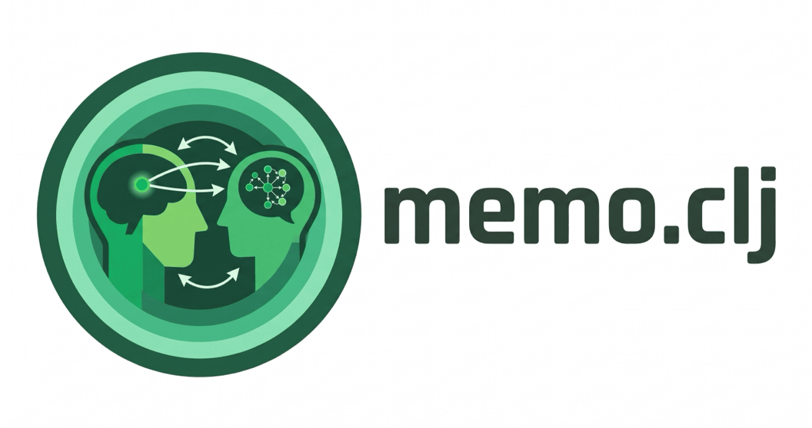

<p align="center">
  
</p>

[memo](https://github.com/kach/memo) on the JVM, built on
[gen.clj](https://github.com/robert-johansson/gen.clj).

memo (Chandra, Chen, Tenenbaum & Ragan-Kelley, PACMPL 2025) is a
probabilistic programming language for recursive reasoning about minds:
agents choose, think about each other's choices, observe, know and want,
and a model computes exact answers over finite domains. memo.clj writes the
same models in Clojure, compiles them to gen.clj's array programs, and gives
Python memo's numbers. It is an independent port, not affiliated with
memo's authors.

**Status: 1.0.1.** 1.0.0 shipped on 2026-10-26. 1.0.1 adds the license and
these documents, and changes no code.
- **Parity.** Every statement and expression of Python memo 1.3.3 except
  cost reflection. Parity tests against memo's test suite, its Handbook,
  and the demos that run without torch or JAX physics (33 of 36). Compile
  errors give memo's messages, and differential fuzzing runs against
  Python memo.
- **Backends.** Runs on gen.clj's backends: the JVM by default, needing
  nothing but a JDK, and MLX on Metal and on MLX's CPU (float32 and
  float64). CUDA was tested before 1.0.
- **`memo.gen`.** A memo as a gen.clj distribution or deterministic
  generative function. Minds can then be traced, conditioned on and
  fitted, with gradients, inside gen.clj models.
- **Bounded minds** (experimental, outside 1.0's promise): an agent that
  reasons from k samples, exact over the samples or by Monte Carlo, with
  its budget given at the call.

## A first model

```clojure
(ns example
  (:require [gen.array :as array]
            [memo.core :refer [defmemo]]))

(def Door [0 1 2])

;; Monty Hall: alice picks a door, monty (who knows where the prize is)
;; opens another door without the prize; P(the prize is behind door d)?
(defmemo monty [[pick Door] [reveal Door] [d Door]] []
  (alice :thinks (monty :chooses [prize Door] :wpp 1))
  (alice :knows pick)
  (alice :thinks
    (monty :knows pick)
    (monty :chooses [reveal Door] :wpp (and (not= reveal prize) (not= reveal pick))))
  (alice :observes monty.reveal :is reveal)
  (alice :knows d)
  (return (as alice (Pr (= monty.prize d)))))

;; picked door 0, monty opened door 2
(get-in (array/->clj (monty)) [0 2])
;=> [0.3333333333333333 0.6666666666666666 0.0]
```

## Using it

memo.clj is a git dependency for the Clojure CLI. Depend on it by a release
tag: [the Handbook's Setting Up](HANDBOOK.md#setting-up) gives the
coordinate. After the first download, run `clojure -X:deps prep` once,
since gen.clj compiles its Java binding. Models run on the JVM backend by
default; MLX needs gen.clj's native libraries (gen.clj's README).

## Documentation

- [HANDBOOK.md](HANDBOOK.md): the language, part by part beside the memo
  Handbook, in memo.clj's syntax. It is executable: every example is a test.
- [DESIGN.md](DESIGN.md): the design and the decisions behind it, and where
  memo.clj departs from Python memo, and why.
- [CHANGELOG.md](CHANGELOG.md): what changed, release by release.

## Development

```
clojure -X:test          # every test (the :test alias sets an 8 GB heap)
clojure -X:test:fast     # without the slow ones
clojure -X:test:mlx      # on MLX (gen.clj checked out beside memo.clj, its native libraries built)
clojure -X:dev:test      # against a gen.clj checkout beside memo.clj
```

**The Python oracle (optional).** The parity fixtures are committed, so the
tests run without Python. Tests that need Python memo itself skip with a
note. To regenerate fixtures or run differential fuzzing, clone
[memo-mcp](https://github.com/robert-johansson/memo-mcp) into memo.clj's
root with `--recurse-submodules`; it pins Python memo 1.3.3 as a submodule.
Create its venv as its README says, then:

```
memo-mcp/venv/bin/python -I test/fixtures/generate.py   # regenerate the fixtures
clojure -X:test:fuzz :n 2000 :seed 1                    # a differential fuzzing campaign
```

## Citing memo

Kartik Chandra, Tony Chen, Joshua B. Tenenbaum and Jonathan Ragan-Kelley.
A Domain-Specific Probabilistic Programming Language for Reasoning about
Reasoning. *Proceedings of the ACM on Programming Languages* 9 (OOPSLA2),
2025. doi:[10.1145/3763078](https://doi.org/10.1145/3763078)

## License

MIT ([LICENSE](LICENSE)), Copyright (c) 2026 Robert Johansson.

Parts of memo.clj derive from memo, under its MIT License, Copyright (c)
2024-2025 Kartik Chandra and Tony Chen ([LICENSE-memo](LICENSE-memo)):
- the Handbook, adapted from "The memo Handbook";
- the port of memo's test suite (`test/memo/testpy_test.clj`);
- the twins of its demos (`test/memo/demos/`);
- the Python twins and fixtures generated from them (`test/fixtures/`).
